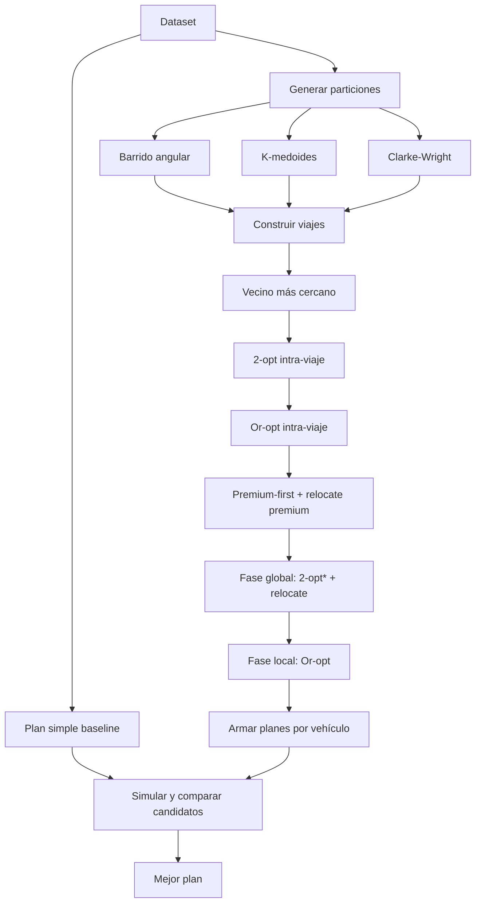

# Algoritmo de generación del plan — QuickDrop

Documento técnico del planificador implementado en `src/lib/plan/` y del simulador de costos en `src/lib/simulacion/`.

---

## 1. Qué resuelve

QuickDrop recibe cada mañana:

- una grilla de 20 × 20 cuadras,
- la ubicación del depósito,
- una lista de pedidos con coordenadas, peso y un flag `premium` opcional,
- una flota de vehículos.

El objetivo es decidir, para cada vehículo, qué pedidos entrega y en qué orden, minimizando el costo total:

```text
costo = distancia total × costo_por_cuadra
      + vehículos usados × costo_por_vehiculo
      + makespan × costo_por_minuto_total
      + minutos premium × costo_por_minuto_premium
      + pedidos fallidos × costo_por_falla
```

No se busca la solución óptima: se busca una solución **válida, razonable y justificable** en tiempos acotados. Por eso el planificador combina varias heurísticas de construcción, dos fases de mejora y una selección final por simulación exacta.

---

## 2. Modelo de tiempos y costos

### 2.1 Tiempo de un vehículo

Cada vehículo arranca en el depósito en `hora_salida` (`t = 0`).

Para cada parada:

- Viajar de `A` a `B` tarda `distancia_manhattan(A, B) × min_por_cuadra`.
- Entregar un pedido suma `tiempo_servicio`.
- Una parada `DEPOSITO` suma el viaje de vuelta al depósito más `tiempo_carga`, y el vehículo vuelve a salir desde el depósito.
- Al terminar la ruta, el vehículo vuelve al depósito. Esa vuelta final suma distancia y tiempo, pero no `tiempo_carga`.

El **makespan** es el tiempo del vehículo que termina más tarde.

### 2.2 Costo premium

Para cada pedido premium entregado se acumulan los minutos desde `hora_salida` hasta el instante en que **empieza** su entrega, es decir, al llegar a la parada y antes de sumar `tiempo_servicio`.

```text
costo_premium = costo_por_minuto_premium × Σ llegada(p) para cada pedido premium p entregado
```

Los pedidos premium que fallan no suman. Los `DEPOSITO` intermedios también retrasan a los pedidos premium que vienen después, porque el reloj del vehículo sigue corriendo.

### 2.3 Distancia

Se usa distancia Manhattan:

```text
| x1 - x2 | + | y1 - y2 |
```

---

## 3. Vista general del pipeline



El planificador no ejecuta un único algoritmo, sino que genera **muchos candidatos** y se queda con el de menor costo simulado.

---

## 4. Orden de ejecución de los sub-algoritmos

### 4.1 Plan simple (baseline)

Función: `construirPlanSimple` / `generarPlanSimple`.

- Usa un solo vehículo: el primero de la flota.
- Ordena todos los pedidos con **premium primero** y, dentro de cada grupo, por `id`.
- No aplica clustering ni mejoras.
- Se agrega como candidato base para que el planificador nunca devuelva algo peor que esta referencia.

**Qué resuelve:** garantizar que siempre exista un plan válido y simple, incluso si las heurísticas más caras fallan o no encuentran mejoras.

---

### 4.2 Generación de particiones

Para explorar distintas formas de agrupar pedidos, se generan particiones para `k = 1 .. maxParticiones`, donde:

```text
maxK          = min(cantidad_vehiculos, cantidad_pedidos, 50)
maxViajes     = min(cantidad_pedidos, 14)
maxParticiones = max(maxK, maxViajes)
```

Cada partición es una lista de clusters; cada cluster será un **viaje** (sale y vuelve al depósito).

#### 4.2.1 Barrido angular (sweep)

Función: `clusterizarSweep`.

1. Ordena los pedidos por ángulo alrededor del depósito.
2. Desempata por distancia al depósito y luego por `id`.
3. Rota el orden para probar distintos puntos de corte.
4. Divide la lista rotada en `k` grupos contiguos de tamaño balanceado.

Rotaciones usadas:

- `0`
- `n / 4`
- `n / 2`
- `3n / 4`

(solo si hay al menos 6 pedidos).

**Qué resuelve:** generar clusters geográficamente compactos y radiales, que suelen funcionar bien en logística urbana. Las rotaciones evitan depender de un único corte arbitrario.

#### 4.2.2 K-medoides

Función: `clusterizarKMedoides`.

1. Inicializa `k` medoides con la estrategia **farthest-first**: el primero es el pedido más lejano al depósito; los siguientes son los más lejanos a los medoides ya elegidos.
2. Asigna cada pedido al medoide más cercano.
3. Recalcula cada medoide como el miembro del cluster que minimiza la suma de distancias a los demás.
4. Repite hasta que no cambie la asignación o se agote el máximo de iteraciones.

Iteraciones máximas:

- 30 si hay ≤ 100 pedidos,
- 15 si hay ≤ 300,
- 8 si hay más.

Solo se usa si hay ≤ 300 pedidos y `k ≤ 14`.

**Qué resuelve:** obtener clusters más “centrados” que el sweep, sin depender de un orden angular. Es útil cuando los pedidos no siguen un patrón radial.

#### 4.2.3 Clarke-Wright (ahorros)

Función: `generarSnapshotsClarkeWright`.

1. Empieza con un viaje por pedido.
2. Calcula el ahorro de unir dos pedidos `i` y `j`:

   ```text
   ahorro(i, j) = d(depósito, i) + d(depósito, j) - d(i, j)
   ```

3. Ordena los ahorros de mayor a menor.
4. Fusiona dos rutas si `i` y `j` son extremos de sus rutas y pertenecen a rutas distintas.
5. Guarda un **snapshot** cada vez que la cantidad de rutas cambia y entra en el rango buscado.

Solo se ejecuta si hay ≤ 600 pedidos.

**Qué resuelve:** construir rutas con buena relación distancia/ahorro, partiendo de una lógica de “¿conviene unir estos dos pedidos?”. Es una heurística clásica de VRP que suele dar soluciones compactas.

---

### 4.3 Construcción de cada viaje

Función: `construirRuta`.

Recibe un cluster y devuelve una secuencia ordenada de pedidos. El orden de los sub-algoritmos es:

#### 4.3.1 Vecino más cercano

Función: `ordenarPorVecinoMasCercano`.

- Arranca en el depósito.
- En cada paso elige el pedido no visitado más cercano.
- Desempata por `id`.

**Qué resuelve:** obtener rápidamente una ruta inicial razonable, sin dejar pedidos lejanos para el final por casualidad.

#### 4.3.2 2-opt intra-viaje

Función: `mejorarConDosOpt`.

- Prueba invertir segmentos de la ruta.
- Acepta el cambio si reduce la distancia.
- Repite hasta que no haya mejora o se agote el límite de pasadas.

Límite de pasadas:

- 120 si la ruta tiene ≤ 300 pedidos,
- 40 si tiene ≤ 800,
- 12 si tiene más.

**Qué resuelve:** eliminar cruces dentro de un mismo viaje. Es la mejora clásica de rutas y suele reducir bastante la distancia.

#### 4.3.3 Or-opt intra-viaje

Función: `mejorarConOrOpt`.

- Prueba mover segmentos de 1 a 3 pedidos a otra posición de la misma ruta.
- Prueba también el segmento invertido.
- Acepta el cambio si reduce la distancia.
- Hasta 25 pasadas.
- Solo se aplica si la ruta tiene ≤ 400 pedidos.

**Qué resuelve:** reubicar bloques pequeños que el 2-opt no puede acomodar bien. Complementa al 2-opt y suele mejorar la solución inicial.

#### 4.3.4 Tratamiento premium

Si el cluster tiene al menos un pedido premium, `construirRuta` genera una segunda ruta candidata:

1. **Premium-first** (`ordenarPremiumPrimero`):
   - Arma primero el tramo de pedidos premium con vecino más cercano.
   - Luego continúa con los no premium, también con vecino más cercano desde el último pedido premium.
2. **Relocate premium-aware** (`mejorarConPremium`):
   - Mueve pedidos de posición dentro del viaje.
   - Evalúa el costo completo del viaje, incluyendo el término premium.
   - Solo se aplica si el viaje tiene ≤ 120 pedidos.
3. Se compara el costo de la ruta premium-first contra la ruta construida por distancia y se queda la mejor.

**Qué resuelve:** adelantar pedidos premium cuando el ahorro por entregarlos antes compensa el costo extra de distancia o de ruta. Si el premium no compensa, se conserva la ruta optimizada por distancia.

---

### 4.4 Fase global: 2-opt* + relocate

Función: `optimizarGlobal`.

Se ejecuta **después** de construir todos los viajes de una partición y **antes** de la fase local.

Entrada: lista de viajes (`Pedido[][]`).
Salida: lista de viajes mejorada, posiblemente con menos viajes.

#### Movimientos que evalúa

**Relocate (entre viajes):**

- Saca un pedido de un viaje.
- Lo inserta en cualquier posición de otro viaje.
- Si el viaje de origen queda vacío, se elimina.

**2-opt\* (entre viajes):**

- Corta dos viajes `A` y `B` en las posiciones `i` y `j`.
- Intercambia las colas:

  ```text
  A' = A[0..i) + B[j..]
  B' = B[0..j) + A[i..]
  ```

- Si un viaje queda vacío, se elimina.
- Se descartan los casos que no cambian nada (identidad y swap completo).

#### Estrategia de búsqueda

- **Best improvement**: en cada iteración se evalúan todos los movimientos posibles y se aplica el mejor.
- Se repite hasta que no haya mejora o se agote el presupuesto.
- El costo que guía la búsqueda es:

  ```text
  costo_conjunto = Σ distancias × costo_por_cuadra
                 + Σ minutos premium × costo_por_minuto_premium
                 + makespan × costo_por_minuto_total
                 + cantidad_de_viajes × costo_por_vehiculo
  ```

  donde `makespan` es la duración máxima entre los viajes.

#### Límites adaptativos

| Pedidos totales | Iteraciones máximas | Presupuesto de movimientos |
| --------------- | ------------------- | -------------------------- |
| ≤ 80            | 10                  | 25.000                     |
| ≤ 200           | 5                   | 10.000                     |
| > 200           | 2                   | 3.000                      |

**Qué resuelve:** mejorar la distribución de pedidos **entre** viajes. El 2-opt y el Or-opt solo reordenan dentro de un viaje; esta fase puede:

- mover un pedido a un viaje vecino,
- intercambiar colas entre viajes,
- fusionar viajes cuando el costo fijo del vehículo no compensa mantenerlos separados,
- acercar pedidos premium a los primeros lugares de otros viajes.

Es la fase que más impacto tiene cuando la partición inicial no es ideal.

---

### 4.5 Fase local: Or-opt

Función: `optimizarLocal`.

Se ejecuta **después** de la fase global, sobre cada viaje resultante.

- Si el viaje tiene menos de 3 pedidos, no hace nada.
- Si tiene pedidos premium y ≤ 120 pedidos: usa `mejorarConOrOptCosto`, que evalúa el costo premium-aware del viaje.
- Si no tiene premium o es muy grande: usa `mejorarConOrOpt`, que optimiza distancia.

#### Or-opt premium-aware

`mejorarConOrOptCosto`:

- Mueve segmentos de 1 a 3 pedidos (1 a 2 si el viaje es grande).
- Prueba inserción normal e invertida.
- Evalúa el costo completo del viaje:

  ```text
  distancia × costo_por_cuadra
  + minutos premium × costo_por_minuto_premium
  + duración × costo_por_minuto_total
  ```

- Pasadas máximas: 6 si ≤ 40 pedidos, 3 si ≤ 80, 1 si es más grande.

**Qué resuelve:** después de que la fase global mueve pedidos entre viajes, las rutas internas quedan desordenadas. El Or-opt local vuelve a acomodarlas, ahora considerando el costo premium y no solo la distancia.

---

### 4.6 Armado de planes por vehículo

Cada conjunto de viajes se convierte en uno o más planes candidatos.

#### 4.6.1 Un vehículo por viaje

Función: `planDesdeViajes`.

- Asigna el viaje `i` al vehículo `i`.
- Solo se usa si hay suficientes vehículos para todos los viajes.

**Qué resuelve:** aprovechar la flota para que cada viaje arranque en paralelo desde el depósito. Es la opción que más reduce el makespan y los minutos premium, a cambio de pagar más costo fijo de vehículos.

#### 4.6.2 Empaquetar viajes en menos vehículos

Función: `planConViajes`.

- Recibe una cantidad objetivo de vehículos.
- Ordena los viajes con **premium primero** y luego por distancia descendente.
- Asigna cada viaje al vehículo con menor carga acumulada de distancia.
- Dentro de cada vehículo, ordena los viajes con **premium primero** y luego por distancia ascendente.
- Une los viajes de un mismo vehículo con la parada `DEPOSITO` entre ellos.

**Qué resuelve:** decidir cuántos vehículos usar y cómo repartir los viajes. Un `DEPOSITO` intermedio permite que un vehículo haga varias rutas, pero retrasa los pedidos posteriores. La fase de selección final compara todas las cantidades de vehículos posibles.

---

### 4.7 Simulación y selección final

Función: `simularPlan` y `esMejor`.

Cada plan candidato se simula con el modelo real de tiempos y costos. Se descartan los planes inválidos o incompletos.

El mejor se elige con este orden de prioridad:

1. **Válido** antes que inválido.
2. **Menor costo total**.
3. **Menos vehículos usados**.
4. **Menor `k`** (cantidad de rutas del plan).

**Qué resuelve:** evitar que una heurística “gane” por una métrica proxy. La decisión final siempre se toma con el costo real que reporta el simulador.

---

## 5. Resumen del orden completo

```text
1. Plan simple baseline
2. Para cada k:
   2.1 Generar particiones:
       - barrido angular (4 rotaciones)
       - k-medoides (si aplica)
       - Clarke-Wright (si aplica)
   2.2 Para cada partición:
       2.2.1 Construir cada viaje:
             - vecino más cercano
             - 2-opt intra-viaje
             - Or-opt intra-viaje
             - premium-first + relocate premium (si hay premium)
       2.2.2 Fase global: 2-opt* + relocate iterativo
       2.2.3 Fase local: Or-opt por viaje
       2.2.4 Generar planes:
             - un vehículo por viaje
             - empaquetar viajes en 1..N vehículos con DEPOSITO
       2.2.5 Simular y guardar candidatos
3. Elegir el candidato de menor costo total
```

---

## 6. Qué aporta cada fase

| Fase | Qué hace | Qué problema resuelve |
| --- | --- | --- |
| Plan simple | Un vehículo, premium primero, orden por id | Garantiza una solución base válida |
| Barrido angular | Agrupa por ángulo alrededor del depósito | Clusters compactos y radiales |
| K-medoides | Agrupa por cercanía a medoides | Clusters centrados sin depender del ángulo |
| Clarke-Wright | Fusiona rutas por ahorro | Rutas compactas con buena distancia |
| Vecino más cercano | Orden inicial de cada viaje | Punto de partida rápido y razonable |
| 2-opt intra | Invierte segmentos | Elimina cruces dentro de un viaje |
| Or-opt intra | Mueve bloques de 1 a 3 | Reacomoda pedidos que el 2-opt no mejora |
| Premium-first | Adelanta pedidos premium | Reduce el costo por minutos premium |
| Relocate premium | Mueve pedidos dentro del viaje | Mejora el orden considerando premium |
| 2-opt* + relocate global | Intercambia colas y mueve pedidos entre viajes | Mejora la partición y la asignación |
| Or-opt local | Reordena cada viaje después del global | Refina las rutas movidas |
| Empaquetado con DEPOSITO | Reparte viajes entre vehículos | Decide cuántos vehículos usar |
| Simulación final | Calcula el costo real | Elige el mejor plan sin sesgos de proxy |

---

## 7. Complejidad y límites

El planificador es heurístico y acota el trabajo en varios puntos:

- `MAX_K = 50`: máximo de rutas consideradas en la búsqueda inicial.
- `MAX_TRIPS = 14`: máximo de viajes para k-medoides y particiones.
- `MAX_PEDIDOS_KMEDOIDES = 300`: k-medoides solo para datasets chicos/medianos.
- `MAX_PEDIDOS_CLARKE = 600`: Clarke-Wright solo hasta 600 pedidos.
- 2-opt intra: límite de pasadas según tamaño.
- Or-opt intra: 25 pasadas, solo si la ruta tiene ≤ 400 pedidos.
- Relocate premium: solo si el viaje tiene ≤ 120 pedidos.
- Fase global: presupuesto de movimientos e iteraciones adaptativo.
- Fase local premium: pasadas y largo de segmento adaptativos.
- Plan simple: siempre disponible como fallback.

Estos límites hacen que el tiempo crezca de forma controlada. En pruebas locales:

- 40 pedidos: ~0,6 s.
- 120 pedidos: ~4,6 s.
- 300 pedidos: ~8,4 s.

(Los tiempos son de modo desarrollo y pueden variar según la máquina.)

---

## 8. Ejemplo conceptual

Supongamos 40 pedidos, 5 vehículos y 10 pedidos premium.

1. El plan simple arma una ruta con todos los pedidos, premium primero.
2. El barrido angular genera particiones de 1 a 14 clusters, con 4 rotaciones.
3. K-medoides y Clarke-Wright agregan particiones alternativas.
4. Para cada cluster:
   - se ordena con vecino más cercano,
   - se mejora con 2-opt y Or-opt,
   - si tiene premium, se prueba además una variante premium-first.
5. Para cada partición:
   - la fase global mueve pedidos entre viajes e intercambia colas,
   - la fase local reordena cada viaje resultante.
6. Se generan planes con 1, 2, 3, … vehículos, insertando `DEPOSITO` cuando un vehículo hace más de un viaje.
7. Se simulan todos los planes y gana el de menor costo total.

El resultado suele usar más vehículos cuando el premium es caro (para entregar antes) y menos vehículos cuando el costo fijo de la flota domina.

---

## 9. Glosario

- **Viaje / trip**: secuencia de pedidos que sale del depósito, entrega y vuelve al depósito.
- **Ruta / vehículo**: lo que hace un vehículo en todo el día; puede contener varios viajes separados por `DEPOSITO`.
- **Makespan**: tiempo del vehículo que termina más tarde.
- **Partición**: conjunto de clusters que cubre todos los pedidos.
- **Candidato**: plan completo generado por alguna combinación de partición, orden y cantidad de vehículos.
- **Proxy**: costo aproximado usado para guiar una búsqueda local; la decisión final usa la simulación exacta.
- **Premium**: pedido con costo adicional por minuto hasta su entrega.

---

## 10. Archivos relacionados

- `src/lib/plan/index.ts`: orquestación, generación de particiones y selección final.
- `src/lib/plan/rutas/`: vecino más cercano, 2-opt, Or-opt, premium y construcción de viajes.
- `src/lib/plan/clusterizacion/`: barrido angular, k-medoides y Clarke-Wright.
- `src/lib/plan/optimizacion/`: fase global (2-opt* + relocate) y fase local (Or-opt).
- `src/lib/plan/armado.ts`: armado de planes por vehículo, con `DEPOSITO` cuando corresponde.
- `src/lib/plan/seleccion.ts`: comparación y selección de candidatos.
- `src/lib/simulacion/index.ts`: simulación exacta de tiempos, entregas, premium y costos.
- `src/lib/simulacion/validacion.ts`: validación del plan.
- `src/lib/simulacion/tiempo.ts`: manejo de horas y minutos.
- `src/lib/dataset/`: parseo, normalización y persistencia en `data/db.json`, incluyendo `premium` y `costo_por_minuto_premium`.
- `src/lib/geometria.ts`: `Punto` y distancia Manhattan compartidos.
- `src/lib/formato.ts`: formateo numérico compartido.
- `src/lib/descargas.ts`: descarga de `plan.json` y `plan.csv`.
- `src/lib/plan.ts`, `src/lib/dataset.ts` y `src/lib/simulacion.ts`: fachadas que mantienen los imports públicos (`@/lib/plan`, `@/lib/dataset`, `@/lib/simulacion`).
- `src/types/mundo.ts`: tipos compartidos (`Mundo`, `Pedido`, `Plan`, `Simulacion`, etc.).
- `src/components/Plan.tsx`: orquestador de la visualización del plan.
- `src/components/plan/`: controles, resumen, tabla de rutas y tabla de paradas.
- `src/components/Matriz.tsx`: orquestador del mapa.
- `src/components/matriz/`: celda y leyenda del mapa.
- `src/components/dashboard/`: estados de carga y error del dashboard.
- `src/components/dataset/`: campos de carga de archivos.
- `src/components/ui/`: mensajes de error y éxito reutilizables.
